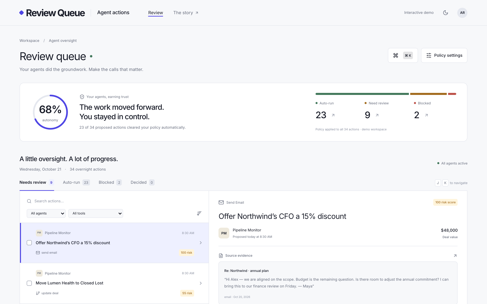

# Agent Action Review Queue

Risk-tiered, human-in-the-loop approval for AI agents working inside a CRM: auto-run routine actions, review consequential ones with evidence and a diff, and block policy violations. Every decision lands in an audit trail. **Built with Codex, verified by Claude Code.**

This is an independent, open-source project. Every customer, contact and proposed action in the demo workspace is fictional. No model, email, billing, Slack or database service is called. The root route redirects to the animated `/story` explainer, and the interactive workspace is at `/review`.



## The problem

Agentic CRMs now let AI agents send follow-up emails, move deals between stages, change subscriptions and post in shared Slack channels without a human in the loop. Builders in this space call agent permissioning an unsolved problem. Users of popular AI SDR and agentic CRM tools report damaged email domains, spam complaints, and discounts or pricing promises nobody signed off on. A common piece of advice from sales leaders is to manually review the first thousand emails an AI SDR sends.

Today's controls tend to be one of two extremes:

- **Scopes** say whether an agent *can* use a tool. They do not say whether *this specific action* should run now, such as a $40k stage change or a discount email to a CFO at a strategic account.
- **Per-tool approval** (for example the AI SDK's `needsApproval`) asks a human about every call. That does not scale once agents run thousands of tasks a month, so reviewers either rubber-stamp everything or turn the agents off.

## Why this feature

Two candidates were considered:

1. **Deal-freshness auto-updates** keep pipeline records current from emails and meetings. That is useful, but it helps one agent, and most agentic CRMs already ship a version of it.
2. **An action review queue** sits in front of *every* agent, including the deal-update agent. It turns approval from a yes/no gate into a policy decision.

The review queue won because it removes the real blocker to agent adoption, which is trust, and because it plugs into the approval hook teams already use (`needsApproval` in the Vercel AI SDK).

## What it does

- **Scores** every proposed action with 14 deterministic, explainable rules: deal size, stage changes, executive recipients, strategic accounts, first touch, money tools, pricing language, external Slack, quiet hours and the agent's track record. Three rules are hard blocks (scope violation, do-not-contact, discount cap).
- **Routes** each action to *auto-run*, *review* or *blocked* using a team-tunable threshold.
- **Shows evidence** next to the action: the source email or meeting, the drafted message, a field-level diff for record changes, and a points breakdown of why it was flagged.
- **Decides fast**: approve, edit then approve, reject with a required reason, batch approve, undo, keyboard shortcuts (`j`/`k`/`a`/`r`) and a `⌘K` command palette.
- **Audits** every decision with an append-only timeline. Undo adds compensating events and never erases history.
- **Tunes trust**: a policy drawer changes thresholds and limits and toggles rules, and the autonomy meter updates live.

## Measured impact (computed from the 34-action seed)

| Metric | Default policy (threshold 40) | Relaxed policy (threshold 50) |
| --- | ---: | ---: |
| Auto-run / review / blocked | 23 / 9 / 2 | 26 / 6 / 2 |
| Autonomy (actions cleared automatically) | **68%** | **76%** |
| Policy-violating actions that can be approved | 0 | 0 |

Compared with per-tool approval, where a human reviews 34 of 34 actions, the default policy sends 9 to a human and auto-runs the other 23 under explicit rules. The ~2 min → ~15 s per-review time on `/story` is an estimate that assumes evidence and batch approval are shown inline. It is not a measured result.

## Run

Node.js 22+ and pnpm 10 are recommended. All dependencies and fonts are installed locally. Installation requires registry access; app execution, tests, and builds require no credentials or external service calls.

```sh
pnpm install
pnpm dev
# http://localhost:3000/story
# http://localhost:3000/review
```

```sh
pnpm test
pnpm typecheck
pnpm lint
pnpm build
pnpm start
```

`.env.example` documents the unused future Supabase variables. Do not supply real credentials. `.gitignore` excludes `.cache/`, `node_modules/`, `.venv/`, build output, and environment files.

## Try the feature

1. Start with **23 auto-run / 9 review / 2 blocked**, showing **68% autonomy**.
2. Open the Northwind CFO email. Read the evidence, draft, and individual risk signals. Edit the draft, approve it, and inspect the Decided tab and audit trail.
3. Select three review items and choose **Approve selected**. Undo restores the batch and appends compensating audit events.
4. Reject an action with a required reason. Blocked actions cannot be approved.
5. In **Policy settings**, change the threshold from 40 to 50. On a fresh queue this yields **26 auto-run / 6 review / 2 blocked**, or **76% autonomy**. Previously decided actions keep their original tier.
6. Toggle rules or change the large-deal / discount limits to explore the trade-offs. Disabling a hard-block rule explicitly disables that guardrail.
7. Use `j`/`k` to navigate, `a` to approve, `r` to reject, and `⌘K` / `Ctrl+K` to open commands. Shortcuts pause while editing or in dialogs.

The Inbound Triage batch command approves only its pending review actions below score 50. At the default policy the internal tasks already auto-run; the command reports when nothing matches. Lower the threshold to explore additional review actions.

The `/story` explainer covers the problem space, the permissioning problem, animated before/after routing, feature decision, three-step workflow, and impact. Entrance and scroll motion, moving routing dots, looping mini demos, and the 68% → 76% metric respect reduced-motion preferences. Seed-derived outcomes are identified as simulated; the ~2-minute → ~15-second review-time estimate is explicitly not measured.

## Policy rules

Scores sum enabled rule points, clamp to 0–100, and expose explanations sorted by points. Hard blocks override the score. Other actions need review when `score >= reviewThreshold` (40 by default).

| Rule                | Condition                                                                |     Points |
| ------------------- | ------------------------------------------------------------------------ | ---------: |
| Deal amount         | ≥ $25k; ≥ four times threshold                                           |  +15 / +25 |
| Stage change        | Backwards or Closed Won/Lost                                             |        +25 |
| Executive recipient | CEO, CFO, CTO, COO, VP, Founder or spelled-out chief/VP title            |        +30 |
| Strategic account   | Company tagged strategic                                                 |        +20 |
| First touch         | No prior conversation with recipient domain                              |        +15 |
| Money tool          | Stripe subscription change                                               |        +35 |
| Pricing language    | Discount, %, price, refund or contract                                   |        +25 |
| External Slack      | Shared/external channel                                                  |        +20 |
| Quiet hours         | Recipient-local 20:00–06:59                                              |        +10 |
| Agent track record  | Approval rate below 80%; at least 95%                                    |  +15 / −10 |
| Low-impact internal | Create task                                                              |        −20 |
| Scope violation     | Tool absent from agent scope                                             | Hard block |
| Do not contact      | Email recipient opted out                                                | Hard block |
| Discount cap        | Refund/discount percentage above 20%; explicit email discount percentage | Hard block |

The five specified tool shapes have no separate note tool, so internal notes are represented as internal tasks. Agent approval rates are seeded rolling-review aggregates, not calculated from this session's small audit sample. Absolute refunds use the related deal amount as the demo's percentage denominator; production must use the actual refundable invoice balance.

## Architecture

- `src/lib/types.ts`: Zod schemas for domain records, discriminated action payloads, policy, and audit events.
- `src/lib/policy.ts`, `score.ts`: deterministic rules and routing, shared by the app, story, API, and AI SDK adapter.
- `src/lib/queue.ts`: pure reducer for approve, edit, reject, batch, undo, and policy changes. Edits are schema-validated and checked against hard blocks before approval. Every decision has an immutable audit event. Undo appends compensation rather than erasing audit history.
- `src/data/seed.ts`: 34 validated actions from four agents across eight fictional companies. Time is frozen at `2026-10-21T08:30:00-07:00`.
- `src/lib/repo/action-repository.ts`: `ActionRepository` boundary. `InMemoryActionRepository` validates and clones its data; the server loads initial review actions through it.
- `src/lib/repo/supabase.stub.ts`, `supabase/schema.sql`: commented integration guide and a reference Postgres schema with RLS enabled and deny-by-default access. Production needs workspace membership policies, authentication, and transactional audit/status writes.
- `src/lib/ai/approval.ts`: `makeNeedsApproval(policy, ctxResolver)` uses the AI SDK tool callback shape `(input, { toolCallId, messages })`. Auto returns false, review returns true, and blocked throws `PolicyBlockedError`.
- `src/lib/ai/tools.ts`: five real `ai.tool` definitions with Zod input schemas and approval hooks. Context is bound by the trusted host; no model or tool executor is connected. [AI SDK approval documentation](https://ai-sdk.dev/docs/ai-sdk-core/tools-and-tool-calling).

Optional demo APIs: `GET /api/actions?threshold=50` returns scored actions; `POST /api/actions/:id/decision` accepts `{"decision":"approve"}` (optional `editedPayload`) or `{"decision":"reject","reason":"..."}`. They validate input and reject blocked, auto, or repeated decisions. API data is process-local and is a separate demo session from the client reducer. The browser session resets on refresh; this is intentionally not durable storage or an authenticated multi-user system.

## Stack

Next.js 16 App Router, React 19, strict TypeScript 5, pnpm, Tailwind CSS v4, locally bundled Inter, Radix primitives, class-variance-authority, clsx, tailwind-merge, lucide-react, cmdk, Zod, Vercel AI SDK 6, Motion 12, and Sonner. Vitest, Testing Library, and jsdom cover logic and components. The lockfile pins the installed versions. Next.js output is deployable to Vercel.

## Screenshots and validation

- Review screenshots: [desktop](docs/review.png), [mobile](docs/review-mobile.png), [dark](docs/review-dark.png).
- Story screenshots: [desktop](docs/story.png), [mobile](docs/story-mobile.png), [dark](docs/story-dark.png). `docs/story.gif` is an optional recording placeholder.
- Unit/component tests cover every rule's enabled/disabled and firing/non-firing behavior, seed distributions, score ordering/clamping, approval adapter, reducer transitions/audit integrity, repository isolation, field diffs, review interactions, six-section reduced-motion story rendering, and server hydration under reduced motion.

## Next steps

Learn weights from reviewer feedback; add team-specific policies and Slack approval buttons; graduate agents after a sustained ≥95% approval rate; wire workspace-authenticated Supabase transactions and actual tool execution with idempotency. Store immutable policy versions and actual execution results separately from review decisions.

Built with Codex, verified by Claude Code. An independent open-source project.

Browser smoke checks run against `pnpm start`: `TMPDIR="$PWD/.cache/tmp" node scripts/browser-smoke.mjs`. Set `CHROME_PATH` if Chrome is installed elsewhere. The script checks review interactions, threshold changes, command palette, dark mode, six viewport widths, story animation, console errors, and the scored API, and saves screenshots under `docs/`.
